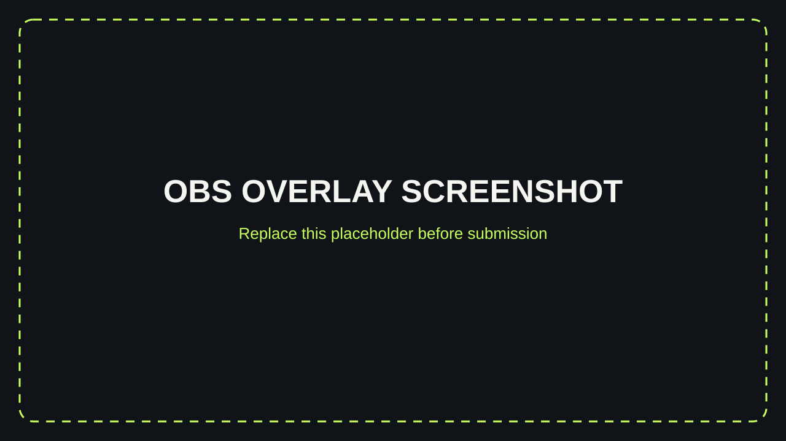
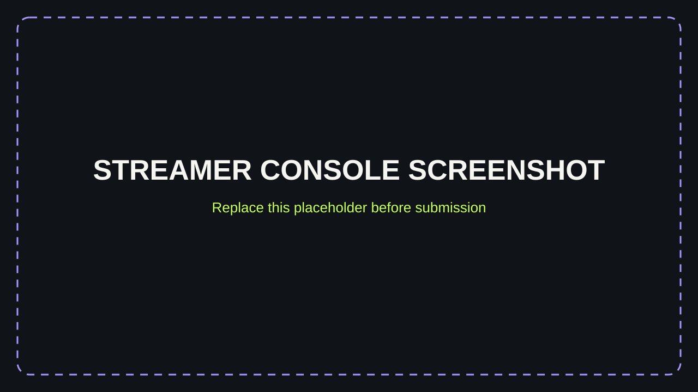
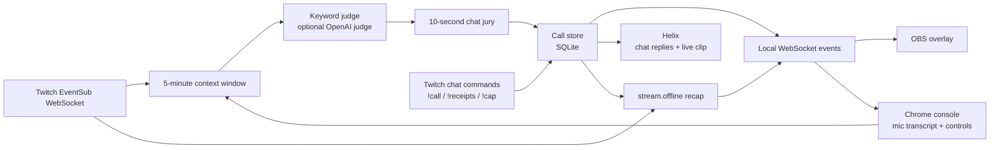

# Called It 

**Every chat has prophets. Now they get receipts.**

Called It lets Twitch viewers make free-text predictions in chat (`!call he rage-quits before the boss`). A judge checks streamer speech and chat reactions for evidence. When a call looks like it came true, chat decides in a 10-second jury: **RECEIPTS** or **CAP**. Confirmed calls get a "CALLED IT" moment on stream and points on the Prophets leaderboard.

- Works for any channel: no Affiliate, Channel Points or Bits needed
- Runs locally and free: EventSub over WebSocket, no hosting
- AI judge with a no-key keyword fallback

Built with OpenAI Codex for the Codex x TwitchCon Hackathon.

## Judge quick start

Requirements: Git and Node.js 20 or newer. The scripted demo needs no Twitch account, `.env`, OpenAI key, or public URL.

### macOS / Linux

```sh
git clone https://github.com/lk-nyoka/called-it.git
cd called-it
npm ci
npm run demo
```

### Windows PowerShell

```powershell
git clone https://github.com/lk-nyoka/called-it.git
Set-Location called-it
npm ci
npm run demo
```

Open <http://localhost:3000/overlay> and <http://localhost:3000/console> after the server starts. The replay tells a scripted four-minute story in roughly 30 seconds, while the juries keep their real 10-second voting windows. The terminal prints fake chat, transcript, judge evidence, votes, and bot replies. It ends with one **CALLED IT** and one **CAP**, then keeps the server open until `Ctrl+C`.

The demo uses the real call command handler, SQLite call store (in memory), keyword judge, reaction-burst detector, jury manager, and overlay WebSocket. Make sure port 3000 is free before starting it. `npm run dev` is the separate live-Twitch mode.

## Screenshots

Replace these labeled slots with screenshots from the final build before submitting:





## Architecture



Twitch, the console, and the judge feed the same local call/context pipeline. The server sends events to both browser surfaces; the OBS overlay shows the jury and stream moments, while the console shows transcript, evidence, and controls.

## Run the live app

From the repository folder:

```powershell
npm install
npm run dev
```

Open <http://localhost:3000/health>; it returns `{"status":"ok"}`. Stop the server with `Ctrl+C`.

Run checks with `npm test`; `npm run lint` checks TypeScript. The demo command above is also the no-credentials end-to-end preview.

### Authorize Twitch chat

The bot uses two separate Twitch logins so it can read chat as the bot account and receive the broadcaster's permission for this channel:

1. Add the Twitch app's client ID, client secret, redirect URL, `BROADCASTER_LOGIN`, and `BOT_LOGIN` to `.env`. Do not share or commit `.env`. The redirect URL must exactly match `http://localhost:3000/auth/callback` in the Twitch Developer Console.
2. Start the app with `npm run dev` and open <http://localhost:3000/auth/bot>. Sign in as the account named by `BOT_LOGIN` (for example, `calleditbot`) and approve chat read, chat send, and bot identity permissions.
3. Open <http://localhost:3000/auth/broadcaster>. Sign in as the channel owner named by `BROADCASTER_LOGIN` and approve the bot's channel permission and `clips:edit` for live clip creation.
4. Check <http://localhost:3000/auth/status>. It should show both logins. Tokens are saved locally in `data/tokens.json`, which Git ignores.
5. In the broadcaster's Twitch chat, type `!help` to see the current commands.

Use separate browser profiles or log out between the two authorizations so Twitch doesn't silently reuse the first account. OAuth codes are short-lived and only used on the local callback. The app refreshes tokens when needed. If the wrong Twitch account is authorized, the callback rejects it and does not save that token.

The bot requests `user:read:chat`, `user:write:chat`, and `user:bot`; the broadcaster grants `channel:bot` and `clips:edit`. Chat arrives over EventSub WebSocket, and replies use Twitch's Send Chat Message API. If subscription is rejected, make the bot account a moderator in the broadcaster's channel, then restart and authorize again.

If you already authorized the broadcaster before adding clips, open <http://localhost:3000/auth/broadcaster> again and approve the new `clips:edit` permission. The bot account does not need to sign in again. Clip creation is skipped unless the broadcaster is live and the stored token includes that scope; any Helix failure is quiet. Twitch's `stream.offline` event automatically shows a recap of the session's boldest correct call, biggest CAP, and top prophet.

### Chat commands available now

- `!call <prediction>` creates a call from 5 to 120 characters. Each viewer can have one open call; the channel can have 30. Calls expire after 30 minutes. The starter blocklist rejects common English profanity before it is saved.
- `!mycalls` lists your recent calls and their status.
- `!prophets` lists the top five point earners.
- Broadcaster and moderators can use `!yes <id>` to confirm a call and award points, `!no <id>` to mark it incorrect, or `!nuke <id>` to remove it from the open calls.
- Judge flags at confidence 0.6 or higher automatically open a 10-second jury; additional flagged calls queue and open one at a time. Broadcaster and moderators can also use `!jury <id>` or the console's **Open jury** button. Viewers vote once with `!receipts` or `!cap`; the call author cannot vote. A receipts result needs at least two votes and 60% support to confirm; a CAP majority marks the call incorrect. A tie stays open. With no votes, judge confidence of 0.85 or higher confirms the call; otherwise it stays open. A short cooldown prevents immediate repeat juries. `!yes`, `!no`, and `!nuke` remain moderator overrides. `!calledit` is the help command.
- Human non-command chat is also included in the rolling five-minute judge context. Similar reactions from at least three distinct chatters within five seconds become burst evidence; one person repeating themselves is not a burst. The call author, the configured bot, and known or configured chat bots are excluded. Add extra bot logins as a comma-separated `CHAT_BOT_LOGINS` value in `.env` if your channel uses other bots.
- Burst detection is configurable with `CHAT_BURST_MIN` and `CHAT_BURST_WINDOW_SECONDS` in `.env` (defaults: `3` and `5`). For a two-person test, set `CHAT_BURST_MIN=2`, keep `CHAT_BURST_WINDOW_SECONDS=5`, restart the server, then have two different non-author viewers send similar evidence messages within five seconds.
- Broadcaster and moderators can use `!judge on` or `!judge off` to pause or resume the 15-second judge checks.
- If the leaderboard has no points yet, `!prophets` replies: `No prophets yet. Be the first to call it!`
- Duplicate calls, invalid lengths, full call lists, missing command arguments, unavailable calls, and missing moderator permissions all get a short chat reply.

### OBS overlay

Run the server and open <http://localhost:3000/overlay?test=1> in a browser to preview the rotating ticker, jury countdown and tally, CALLED IT card, Hall of Cap, leaderboard, and session recap. The preview uses sample data and synthetic Web Audio tones, so it needs no Twitch chat activity.

To add it to OBS Studio:

1. Start Called It with `npm run dev`.
2. In OBS, select your scene, click **+** in **Sources**, and choose **Browser**.
3. Set the URL to `http://localhost:3000/overlay?test=1`, Width to `1920`, and Height to `1080`.
4. Click **OK**. The page background is transparent; place the source above your game or camera sources.
5. When you are ready to use real calls, change the URL to `http://localhost:3000/overlay`.

The overlay receives open-call snapshots, active jury state, live tally updates, and celebration/cap/leaderboard/recap events over the local `/ws` WebSocket. Its jury card displays `!receipts` and `!cap`. A CALLED IT card holds for five seconds and a Hall of Cap card for three before the next jury begins its full voting window. The `!prophets` card stays up for eight seconds.

### Streamer console

Open <http://localhost:3000/console> in **Chrome** while the server is running. Click the microphone button and allow microphone access; Chrome adds final speech results to the live transcript and the rolling five-minute context window. The mic restarts recognition if Chrome stops the continuous session. Click the button again to stop it. Speech recognition is provided by Chrome's Web Speech API.

The console also shows open calls with Confirm, Reject, and Nuke controls, plus the judge toggle. These update the same call store and judge setting as the chat commands. Open call changes and context entries sync over the local `/ws` connection. The context window is in memory and is not saved between server restarts.

When the judge is on, it checks every 15 seconds when there are open calls and new context. A suggestion appears inside the matching call card with its confidence and an exact quote from the transcript or event, and the bot announces the evidence in chat. Suggestions at 60% confidence or higher automatically open a jury; additional suggestions queue while one is active. A broadcaster or moderator can also use `!jury <id>` or **Open jury** in the console. Calls show their saved boldness score from 1 to 5. The free keyword judge assigns 2.

The default `JUDGE_PROVIDER=keyword` needs no API key. It matches meaningful words and names, ignores basic negation, and honors simple deadlines such as `in the next 5 minutes`. To use the optional OpenAI judge, set `JUDGE_PROVIDER=openai` and add `OPENAI_API_KEY` to `.env`. It uses `gpt-6-luna` with structured JSON output and a seven-second timeout; missing keys, errors, timeouts, and invalid responses fall back to the keyword judge. The OpenAI option sends the active calls and eligible recent context to OpenAI and may incur API usage charges. If the key is missing, it stays on the free keyword judge.

To test the judge live:

1. Run `npm run dev`, open <http://localhost:3000/console> in Chrome, and click the mic button.
2. In your Twitch chat, type `!call Mira finds the golden key in the next 5 minutes`.
3. After the call is locked in, say: “Mira finds the golden key in the vault.”
4. Wait for the next check (up to 15 seconds). The call should show a **JUDGE FLAG**, quote the sentence it matched, and automatically open a jury. If another call is flagged during that jury, it should wait in the queue.
5. In Twitch chat, vote `!receipts` or `!cap` as a viewer other than the call author. Check the live overlay tally and that the jury closes after 10 seconds. `!calledit` should display help.
6. For no-vote handling, let a high-confidence jury expire with no votes to confirm the call; with lower confidence it should stay open. A tie should also stay unresolved. Use the console's **Open jury** button or moderator `!jury <id>` to open one manually.
7. To verify the pre-call guard, say the matching sentence first, then make the call; that earlier sentence must not trigger a judge flag. Say it again after the call to test a valid match.

Use `!judge off` / `!judge on` in chat, or the console switch, to pause and resume checks. During a jury, viewers vote with `!receipts` or `!cap`. `!calledit` displays help. `!yes <id>` still confirms a call and awards its boldness-based points.

Incoming Twitch raids are included when the EventSub subscription succeeds. Twitch's `channel.raid` EventSub does not require an additional authorization scope. Follows are not included: `channel.follow` requires the `moderator:read:followers` scope, which the current authorizations do not grant. The app skips that subscription and does not ask you to reauthorize.

The console is intended for local use. Its write APIs reject browser requests from a different origin.

See [`AGENTS.md`](AGENTS.md) for the full spec and [`docs/CODEX_PLAN.md`](docs/CODEX_PLAN.md) for the build plan.

## How I built it with Codex

- `AGENTS.md` served as the project spec: it defined the stack, no-cost/local constraints, command rules, judge contract, and overlay behavior.
- Work progressed as small, reviewable steps using prompts for the foundation, Twitch sign-in/chat, SQLite commands, overlay, console, judge, jury, reaction bursts, demo, and polish.
- Each feature was checked with focused Vitest coverage and TypeScript linting as its behavior was added; the demo provides a no-credentials run through the real pipeline.
- Review feedback drove follow-up fixes, including the serialized overlay queue (so the celebration is not covered by the next jury) and keyword-judge negation handling (so “did not find it” does not count as a match).
- Commits keep each feature step and review fix visible in the project history.
